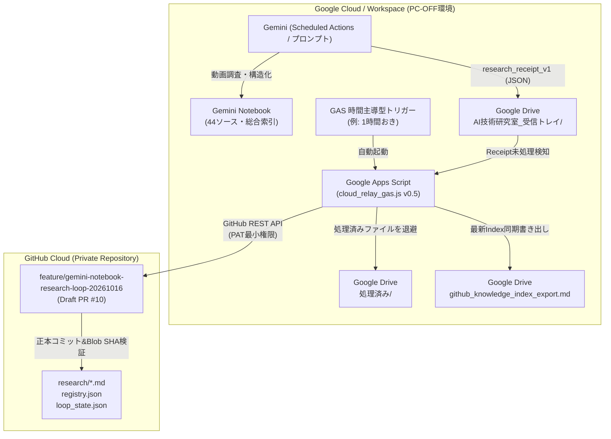

# AI技術研究室｜PC-OFF無人稼働運用仕様書・安全設計ガイド

**改訂日**: 2026-10-17  
**対象システム**: `automation/gemini-notebook/` (v0.5)  
**運用目標**: ユーザーのローカルPCが電源OFFの状態でも、Geminiによる動画調査とGitHubリポジトリへの成果蓄積を安全・自律的に継続する。

---

## 1. 全体アーキテクチャ概要

ローカルPCに依存せず、Google Cloud（Gemini / Drive / Apps Script）とGitHub Cloud間で完結する完全クラウド中継構成をとります。

---

## 2. 稼働状況の厳格な区分（Mock / Ready / Live）

本研究室の最重要ルールに従い、稼働状態を明確に区分します。

| 項目 | 現在のステータス | 判定根拠 |
|---|---|---|
| **ローカル検証（単体・結合テスト）** | **PASS（完了）** | 18件の自動テスト全通過、Case A〜Fの実用検索確認、100本バッチ正規化テスト通過 |
| **GAS中継コード実装** | **WIRED_READY（準備完了）** | `cloud_relay_gas.js` v0.5（3348行）実装済み、Contract Spec・セキュリティ検査準拠 |
| **Google Drive 実フォルダ** | **READY_FOR_LINK（未配線）** | フォルダ構造設計済み（実環境でのフォルダID紐付け待ち） |
| **本番クラウド定期稼働 (Live Trigger)** | **NOT_WIRED（未接続・待機）** | **本番GASデプロイ・定期トリガー設定は未実施**。ユーザー明示承認と手動設定が必要 |

> [!IMPORTANT]
> **本番未稼働の明示**:
> 現在は「PC上でコードを完全実装し、モック・結合テストで動作保証した状態」であり、**Google Workspace上でクラウド中継が実際に自動定期稼働しているわけではありません**。本番自動実行を稼働中と報告してはいけません。

---

## 3. PC-OFF無人稼働のための5大安全境界

1. **mainブランチ直接書き込みの絶対拒否**:
   - `CONTRACT_SPEC_V1.forbidden_branches` により、`main` / `master` への直接コミット・プッシュはコードレベルで即座に例外停止します。
   - すべての自律中継は隔離作業ブランチ（`feature/gemini-notebook-research-loop-20261016`）および Draft PR #10 へ向けられます。
2. **秘密情報・認証情報の機械的遮断**:
   - GitHub PAT、Google APIキー、LLMシークレットキー、Bearerトークン等を正規表現パターンで検査し、1文字でも含まれていればリレー処理を中止（STOP）します。
3. **字幕全文・機密著作物の転載ブロック**:
   - SRT/WebVTTタイムコード形式、3行以上の連続字幕文字起こし、長文転載（過剰な改行）を機械的に検知し拒否します。
4. **推測タイムスタンプの排除**:
   - `allowed_timestamp_sources` から推測ハック（`OFFICIAL_TIME_RANGE`）を全廃。
   - `YOUTUBE_CHAPTER_METADATA`、`TIMESTAMPED_CAPTIONS`、`VISUAL_FRAME_CHECK` のいずれかの客観的証拠がない箇所はすべて `UNKNOWN` とし、`&t=` 再生リンクを生成しません。
5. **GAS 9KBプロパティ制限の保護とGitHub正本SSOT化**:
   - GASの `ScriptProperties` に全履歴を溜め込まず、GitHub側の `loop_state.json` を正本（SSOT）として参照・更新します。

---

## 4. ユーザーによる本番LIVE接続手順（要手動承認）

PC-OFF無人運用を実際に開始する際は、ユーザーが以下のステップを手動で実行します（AIによる勝手な外部LIVEデプロイ・トークン発行は禁止されています）。

### Step 1: Google Drive フォルダの準備
Google Drive上に以下のフォルダを作成します：
- `AI技術研究室_受信トレイ` （Geminiの出力先、GASの監視元）
- `AI技術研究室_処理済み` （中継成功後の退避先）
- `AI技術研究室_エラー退避` （バリデーションエラー時の隔離先）

### Step 2: Google Apps Script プロジェクトの作成
1. [Google Apps Script](https://script.google.com/) で新規プロジェクトを作成。
2. `automation/gemini-notebook/cloud_relay_gas.js` の全文を貼り付けて保存。

### Step 3: スクリプトプロパティ（Script Properties）の設定
GASの「プロジェクトの設定」>「スクリプト プロパティ」に以下を登録：
- `GITHUB_PAT`: リポジトリへの書き込み権限（Contents: Read & Write）を持つFine-grained PAT（最小権限）
- `DRIVE_INBOX_FOLDER_ID`: `AI技術研究室_受信トレイ` のフォルダID
- `DRIVE_PROCESSED_FOLDER_ID`: `AI技術研究室_処理済み` のフォルダID
- `DRIVE_ERROR_FOLDER_ID`: `AI技術研究室_エラー退避` のフォルダID
- `TARGET_BRANCH`: `feature/gemini-notebook-research-loop-20261016`

### Step 4: トリガー（時間主導型）の有効化
GASの「トリガー」設定画面から：
- 実行する関数: `runCloudRelayLoop_`
- イベントのソース: `時間主導型`
- 時間の間隔: `1時間おき`（または1日数回）

---

## 5. 異常検知と復旧手順

- **Receipt破損・バリデーションエラー**:
  - 当該ファイルを `AI技術研究室_エラー退避/` フォルダへ移動し、詳細なエラー理由をログおよび `loop_state.json` の `relay_errors` に記録。GitHub正本を汚染しません。
- **GitHub API レートリミット / 一時的ネットワーク障害**:
  - `retryCount = 3` まで指数バックオフで再試行。回復しない場合は当該実行を安全に中断し、次回トリガーで再開（未完了ファイルを再取得）。
- **Git Tree 競合 / Truncated検知**:
  - リモートHEADが他者により先行更新されていた場合は `STATUS_REMOTE_DIVERGENCE_PAUSE` で安全停止。強制プッシュを行わず、人間の確認を待ちます。
