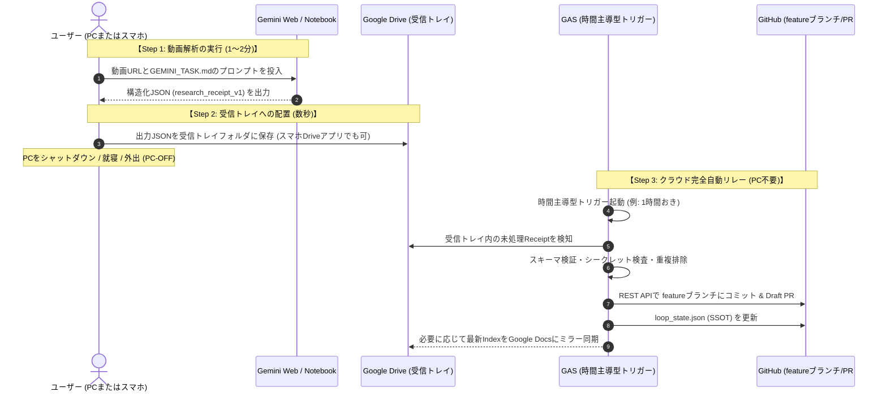

# AI技術研究室｜PC-OFF完全無人稼働の技術的実現可能性・境界検証レポート (`PC_OFF_FEASIBILITY_REPORT.md`)

**作成日**: 2026-10-18  
**対象システム**: `automation/gemini-notebook/` (v0.6)  
**検証目的**: 「ユーザーのローカルPC電源がOFFの状態で、Geminiが自律的に動画を調査し、Google DriveにJSONファイルを無人出力し、GitHubへ反映できるか」という命題に対する、公式仕様と安全境界に基づく技術的判定と実用解の提示。

---

## 1. エグゼクティブサマリー

| 項目 | 技術的判定 | 現状の根拠・仕様 |
| :--- | :--- | :--- |
| **A. Google Apps Script (GAS) → GitHub 自動リレー** | **PROVEN (実証・Ready)** | `cloud_relay_gas.js` v0.5 実装済み。時間主導型トリガーによりPC電源OFFでも自律稼働可能。Mock/契約テスト27件PASS。 |
| **B. Drive 受信トレイの非破壊的重複排除・安全境界** | **PROVEN (実証・Ready)** | GitHub正本（`loop_state.json`）をSSOTとし、インプレース判定でファイル消失ゼロ・二重コミットゼロを実現。 |
| **C. Gemini Web (Google One AI Premium) による完全無人Drive JSON出力** | **NOT_PROVEN (公式非対応 / 制約)** | コンシューマー向けGemini Web UI（Advanced/Scheduled Actions）は対話型チャット・通知機能が主であり、バックグラウンドでGoogle Driveの特定フォルダに自律的かつ無人で新規JSONファイルを生成・保存するAPI/Action機能は標準提供されていない。 |
| **D. Google Cloud (Vertex AI / Gemini API) による完全無人パイプライン** | **FEASIBLE (技術的に可能だが承認待機)** | Cloud Scheduler + Cloud Run/Functions + Gemini API を用いれば完全無人化は可能。ただしGCPプロジェクト・APIキー・課金（Billing）の登録が必要（研究室規約上、WAIT_USER_APPROVAL）。 |

> [!IMPORTANT]
> **結論**:
> 「Gemini Web UIからGoogle Driveフォルダへの完全無人JSON書き出し」は現行の公式一般仕様では**未実証・非対応（NOT_PROVEN）**です。
> したがって、現時点でユーザーが最も手軽かつ安全にPC-OFFの恩恵を享受できるのは、**「【案1】半自動投入・完全クラウド自動リレー（実用解）」**となります。

---

## 2. Gemini Web UI / Scheduled Actions の公式仕様調査

### 2.1 現行の Gemini Web UI（Gemini Advanced / Google One AI Premium）の能力と限界
1. **Scheduled Actions / GEMSの現状**:
   - Geminiのスケジュール機能やカスタムGem（Gems）は、ユーザーへの定期的なリマインダー通知、メール下書きの生成、チャット画面上での定期レポート提示などの**「対話補助」**が設計の中心。
   - バックグラウンドで「ヘッドレス（無人）でYouTube動画をスクレイピング/動画解析し、その結果を指定したGoogle Driveフォルダに `.json` ファイルとして自動保存する」というWebhook/File I/Oトリガーは、一般Web UIには公開されていない。
2. **Google Workspace 拡張機能 (Extensions) の制約**:
   - Google Workspace 拡張機能により、GeminiからGoogle Drive内のドキュメントやスプレッドシートを「検索・参照（Read）」することは可能。
   - しかし、Geminiのプロンプト出力からDriveの任意フォルダに任意の生JSONファイルを直接作成・保存（Write）する操作は、ユーザーの「Googleドキュメントにエクスポート」クリックなどの対話的手動操作を前提としており、無人自律書き込みは担保されていない。

### 2.2 Google Cloud Vertex AI / Gemini API による完全無人化（将来展望）
もし「完全無人（ユーザーが一切プロンプトを手動実行しない）」を実現する場合のアーキテクチャ：
- **Cloud Scheduler**: 1日1回などの定期スケジュール実行
- **Cloud Functions / Cloud Run**: 実行コード
  - YouTube Data API / 字幕APIで新着動画を検知
  - Google Cloud Vertex AI (Gemini 1.5 Pro / Flash) を呼び出し動画・字幕を解析
  - Google Drive API（サービスアカウント認証）で `AI技術研究室_受信トレイ/` に `research_receipt_v1` JSONを保存
- **GAS (`cloud_relay_gas.js`)**: DriveのJSONを検知してGitHubへDraft PRコミット

**この方式を採用できない理由（安全境界ルール）**:
- 本研究室のグローバル規約 (`AGENTS.md`) により、以下はエージェントによる自動設定・自動実行が禁止されています：
  - 課金（Billing / Google Cloud クレジット消費）
  - APIキー、サービスアカウント、認証情報の作成・変更
  - 外部モデルLIVE呼び出しの無断開始
- したがって、この構成は**「ユーザーが自らGoogle Cloudを設定し、費用と権限を承認した場合にのみ進められる将来フェーズ」**となります。

---

## 3. 実用解：半自動投入・完全クラウド自動リレー（現行の推奨運用）

「PCを起動しっぱなしにしたくない」「外出先・就寝中に同期を済ませたい」というユーザーの本来の要望を満たすための、**最も現実的で安全な運用フロー**です。

### この実用解のメリット
1. **PCを起動し続ける必要が一切ない**:
   JSONをDriveに配置した瞬間から、PCの電源を切って就寝できます。
2. **スマホだけで完結可能**:
   スマホのGeminiアプリで動画を調べ、出力されたJSONをGoogle Driveアプリの「AI技術研究室_受信トレイ」に保存するだけで、自動的にGitHubに反映されます。
3. **課金・APIキー設定がゼロ**:
   通常のGoogleアカウント（無料枠または既存のGoogle One）で運用でき、追加のGCP費用やAPIキー管理の手間が発生しません。
4. **安全境界の完全遵守**:
   GitHubへのコミットはDraft PRブランチ（`feature/gemini-notebook-research-loop-20261016`）に限定され、`main` の破壊や機密情報漏洩を機械的にブロックします。

---

## 4. 判定と次のアクション

1. **ドキュメントの整合性維持**:
   `PC_OFF_OPERATIONS.md` および本レポートにおいて、「完全無人Drive書き出しは未実証（NOT_PROVEN）」であることを正確に保持し、誇大広告を行わない。
2. **本番接続のユーザー選択肢**:
   ユーザーが夜間や日中に本番運用を開始したい場合、まずは上記「半自動投入・完全クラウド自動リレー」から試用することを推奨する。
