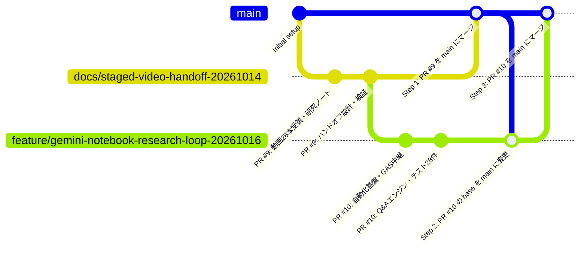

# AI技術研究室｜PR #9・PR #10 依存関係・マージ戦略ガイド (`PR_MERGE_STRATEGY.md`)

**作成日**: 2026-10-18  
**対象リポジトリ**: `kamiyusense/ai-video-research`  
**関連PR**:
- **PR #9**: `docs/staged-video-handoff-20261014` → `main`
- **PR #10**: `feature/gemini-notebook-research-loop-20261016` → `docs/staged-video-handoff-20261014`

---

## 1. ブランチ構成と依存関係（Stacked PR 構造）

本リポジトリでは、大規模な成果を安全に段階的レビューするため、**Stacked PR（階層型プルリクエスト）** アーキテクチャを採用しています。

---

## 2. なぜ PR #10 は `main` ではなく PR #9 をベースにしているのか？

PR #10 のベースブランチが `main` ではなく `docs/staged-video-handoff-20261014` に設定されている理由は以下の通りです：

1. **レビュー差分の純粋性（ノイズの排除）**:
   - PR #10 は、PR #9 で受領・配置された「動画28本の研究記録（`research/*.md`）」や「台帳（`registry.json`）」が存在することを前提として設計されています。
   - もし PR #10 のベースを `main` にしてしまうと、PR #9 に含まれる28本分のMarkdownファイルや大量のテキスト差分が PR #10 のFiles Changedにも二重に混入し、自動化基盤（`automation/`）のコードレビューが極めて困難になります。
   - ベースを PR #9 に設定することで、PR #10 の差分には**「自動化基盤・Q&A検索エンジン・GAS中継・テストスイート」という純粋な追加変更のみ**が表示されます。
2. **段階的な安全検証（土台と機能の分離）**:
   - 土台となる「研究成果の受領内容（PR #9）」と、それを自動化・検索する「システム機能（PR #10）」を明確に分離して検証できます。

---

## 3. 推奨マージ手順（安全な2段階マージ）

将来 `main` ブランチに全成果を取り込む際は、以下の**順番と手順**を遵守してください。

> [!CAUTION]
> **重要（AIによる自動マージの禁止）**:
> 本研究室の安全規約（`AGENTS.md`）により、エージェントが自律的にPRをマージしたり、PRのベースブランチを変更したりすることは禁止されています。以下の操作は**必ずユーザー自身がGitHubウェブ画面で行ってください**。

### Step 1: PR #9 を `main` にマージ
1. GitHub で [PR #9](https://github.com/kamiyusense/ai-video-research/pull/9) を開きます。
2. 差分（動画28本の受領・研究記録・ドキュメント）を確認します。
3. **「Squash and merge」または「Create a merge commit」** を選択して `main` へマージします。
   - ※ブランチ削除の確認が出た場合、PR #10 の切り替えが終わるまでは削除しないことを推奨します。

### Step 2: PR #10 のベースブランチを `main` に切り替え
1. GitHub で [PR #10](https://github.com/kamiyusense/ai-video-research/pull/10) を開きます。
2. PRタイトルの右側にある **[Edit]** ボタンをクリックします。
3. **base: `docs/staged-video-handoff-20261014`** と表示されているドロップダウンをクリックし、**`main`** を選択して保存します。
4. GitHubが差分を自動再計算します。
   - Step 1 で PR #9 がすでに `main` にマージされているため、PR #10 の Files Changed から PR #9 のコミットが綺麗に消え、PR #10 固有の差分（`automation/`, `docs/`, `tests/` 等）のみが `main` に対する差分として残ります。

### Step 3: PR #10 を `main` にマージ
1. PR #10 のCI/テスト（自動チェック）がすべてPASSしていることを確認します。
2. 「Squash and merge」または「Create a merge commit」で `main` にマージします。
3. これで、`main` ブランチに28動画の研究知見と自動化システム・Q&A検索エンジンが完全に統合されます。

---

## 4. 競合（Conflict）リスク分析と対策

- **`registry.json` / `RESEARCH_ROADMAP.md`**:
  PR #10 の作業中、`registry.json` や `RESEARCH_ROADMAP.md` は変更せず、追加ファイル（`automation/gemini-notebook/`、`docs/`、`tests/`）を中心に開発を進めました。
- したがって、Step 1（PR #9マージ）から Step 2（ベース変更）への移行において、**ファイル競合（Merge Conflict）が発生する可能性は極めて低い（クリーンマージ可能）**状態が維持されています。
